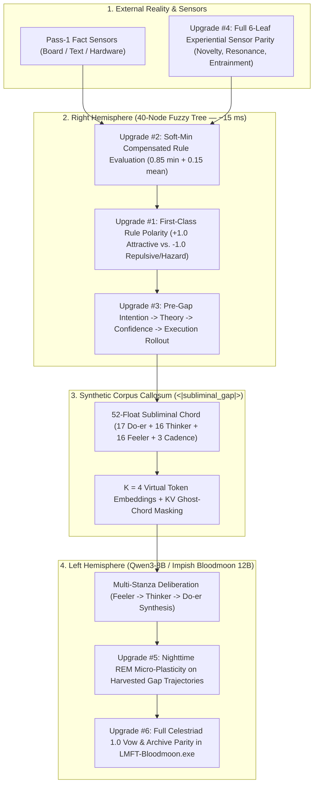

# Architect's Diary & Auditor Briefing: What `Celestriad 1.0` Taught Us About the Core Mind

> **Author**: Schaleh (`@imissmydeadcat.74`) & Antigravity (AI Pair-Architect)  
> **Repository**: [`Dual-Hemisphere-Wisdom-Model`](https://github.com/schaleh12/Dual-Hemisphere-Wisdom-Model)  
> **Contact**: `imissmydeadcat74@gmail.com` · [YouTube (`@imissmydeadcat.74`)](https://www.youtube.com/@imissmydeadcat.74)

  

---

## Prelude: Why Building a Chess Mind Exposed the Next Horizon of the Core Engine

When we first built the **40-Node Language Model Fuzzy Tree (`LMFT-Architecture`)**, the goal was simple to state and hard to engineer:

> *How do you give a local language model a real **Right Hemisphere**—a fast, persistent mathematical sense of balance, geometry, and emotional truth (`~15–35 ms`)—so it stops rationalizing its own mistakes and actually learns when it sleeps?*

Putting **`Celestriad 1.0`** into the **`LMFT-Chess.exe`** arena against a calibrated Stockfish referee was the ultimate truth serum. In ordinary conversation, a language model can hide a structural flaw behind a pretty metaphor. On an 8x8 chessboard, wishful thinking (`Theory`) immediately collides with the geometry of the pieces (`Fact`).

To help `Celestriad 1.0` survive, reflect in multi-stanza prose, and keep its waking vows across games, we had to invent several new mechanisms inside the Chess bridge ([`chess_kibitz_bridge.py`](../src/lmft_architecture/chess_kibitz_bridge.py) and [`chess_app.py`](../src/lmft_architecture/chess_app.py)). Stepping back and comparing what `Celestriad 1.0` does in Chess against the general **`LMFT-Architecture` core** reveals **6 fundamental upgrades and fixes** that belong in the core architecture itself.

> [!IMPORTANT]
> **The Frozen 40-Node Seed Remains 100% Untouched**: None of the 6 upgrades below alter the 40 founding nodes or the 24 founding leaf names in [`birth.py`](../src/lmft_architecture/birth.py). Every upgrade strengthens how the **Three Constitutional Branches**, the **Fuzzy Rule Evaluator**, the **Corpus Callosum (`<|subliminal_gap|>`)**, and **REM Sleep** operate on top of that frozen seed.

---

## Architecture Map: Where the 6 Core Upgrades Live

---

## The Three Constitutional Branches (Quick Reference for Readers & Auditors)

Every scene in `LMFT-Architecture` is weighed by three independent branches before settling:

| Constitutional Branch | Founding Leaf Pair | Cognitive Role | Human Craft & Medium |
| :--- | :--- | :--- | :--- |
| **1. Executive Branch** | `Will <-> Cultural` (`17` chord floats) | **The Do-er** — Purposeful action, commitment, and resource stewardship (`Intention`, `Execution`, `Wastelessness`). | **Poetry & Storytelling** (*Trajectory, action, and consequence*) |
| **2. Legislative Branch** | `Contemplation <-> Experiential` (`16` chord floats) | **The Feeler** — Feels the lived emotional chord first (`Valence`, `Arousal`, `Clarity`) and originates the demand for new laws when a wound occurs. | **Philosophy & Coding** (*First-principles laws born from felt friction*) |
| **3. Judicial Branch** | `Truth (Fact / Theory) <-> Philosophical` (`16` chord floats) | **The Thinker** — The supreme court of proportion, geometry, and harmony, weighing objective reality (`Fact`) against subjective perspective (`Theory`). | **Music & Art** (*Objectively gradeable proportion paired with subjective taste*) |

---

## The 6 Fundamental Core Upgrades (For Patreon Readers & Auditor Review)

### Upgrade #1: First-Class Rule Polarity (`Attractive` vs. `Repulsive / Inhibitory`) in Core `FuzzyConceptRule`

- **Code Locations**:
  - [`FuzzyConceptRule`](../src/lmft_architecture/reflection_classifier.py#L210-L262) in [`reflection_classifier.py`](../src/lmft_architecture/reflection_classifier.py)
  - [`RIGHT_BRAIN_WILL_EDGES`](../src/lmft_architecture/right_brain_equilibrium.py#L166-L176) in [`right_brain_equilibrium.py`](../src/lmft_architecture/right_brain_equilibrium.py)
- **Diary Perspective (Why This Matters)**:
  - Human wisdom has two opposite pedals: a **gas pedal** (*"This pattern is wholesome and sound—lean into it"*) and a **brake pedal** (*"I have been burned by this exact stove / Greek-Gift sacrifice before—pull back!"*).
  - When you recognize a hot stove with **100% confidence**, that high confidence should *stop* your hand from touching it, not encourage it!
- **Auditor Technical Finding**:
  - Right now, `FuzzyConceptRule` has no explicit `polarity` field. In Chess (`chess_kibitz_bridge.py`), we had to distinguish repulsive traps from attractive exemplars by checking `rule.concept_name.startswith("hazard_")` vs. `startswith("coached_")`.
  - Worse, in the general core engine (`right_brain_equilibrium.py:174`), `CONFIDENCE_LEAF -> EXECUTION_LEAF` is hardcoded with a positive weight (`+0.5`). Outside of Chess, if a `hazard_*` rule fires at `0.95` confidence, the core graph treats `confidence = 0.95` as a positive boost to `Execution` rather than an inhibitory brake!
- **Proposed Fix**:
  - Add `polarity: str = "attractive"` (`"attractive" | "repulsive"`, backward-compatible with JSON rulesets and automatically inferred from `hazard_` when loading legacy rules) onto `FuzzyConceptRule`.
  - When the winning rule in `compute_contemplation` / `right_brain_equilibrium.py` has `polarity == "repulsive"`, invert the sign of the `Confidence -> Execution` drive and tug the `<|subliminal_gap|>` chord *away* from the hazard's deficit leaves.

---

### Upgrade #2: Replacing the Brittle `min()` Cliff in `FuzzyConceptRule.evaluate` with a Compensated Soft-Min

- **Code Location**:
  - [`FuzzyConceptRule.evaluate`](../src/lmft_architecture/reflection_classifier.py#L243-L261) in [`reflection_classifier.py`](../src/lmft_architecture/reflection_classifier.py)
- **Diary Perspective (Why This Matters)**:
  - Imagine recognizing a friend's face: their eyes, voice, and posture match 99%, but they are wearing a hat so one feature is only 65% visible. A rigid computer program that only looks at the single lowest score (`min()`) suddenly declares: *"0% match—total stranger!"*
- **Auditor Technical Finding**:
  - Line `258` of `reflection_classifier.py` computes `min_similarity = min(similarities)`.
  - This creates two measurable artifacts:
    1. **Single-Leaf Dropouts**: A 4-leaf rule where 3 leaves match at `0.98` and 1 slightly noisy leaf lands at `0.54` (just below `low = 0.55`) evaluates to **`0.0`**.
    2. **False Ties (`Clarity = 0.0`)**: If Rule A has leaf similarities `[0.72, 0.99, 0.98]` and Rule B has `[0.72, 0.73, 0.74]`, pure `min()` scores both rules identically at `0.72`, causing `clarity = 0.0` (an artificial collision) even though Rule A is overwhelmingly stronger on the other leaves.
- **Proposed Fix**:
  - Use a bounded **Compensated Soft-Min (`0.85 * min_sim + 0.15 * mean_sim`)** (gated so that if `min_sim < 0.35`, no compensation applies). This preserves conjunctive safety while immediately breaking false ties across multi-leaf rules.

---

### Upgrade #3: Bringing Forward Rollout (`Intention -> Theory -> Confidence -> Execution`) Into General Dialogue

- **Code Locations**:
  - [`evaluate_candidate_moves_with_right_brain`](../src/lmft_architecture/chess_kibitz_bridge.py#L1600-L1750) in [`chess_kibitz_bridge.py`](../src/lmft_architecture/chess_kibitz_bridge.py)
  - [`run_three_legged_turn`](../src/lmft_architecture/three_legged_runtime.py#L1650-L1850) in [`three_legged_runtime.py`](../src/lmft_architecture/three_legged_runtime.py)
- **Diary Perspective (Why This Matters)**:
  - In Chess, `Celestriad 1.0` doesn't blurt out a move and only ask afterward whether it was a blunder. It sparks an **`Intention`** (`Ply 1`), imagines how the opponent will reply (**`Theory`**, `Ply 2–3`), checks whether that future stays safe (**`Confidence`**), and only then commits to **`Execution`**.
  - Yet in general conversation outside the chessboard, the core engine still lets the Left Brain speak the first half of a sentence before checking `Theory` at the comma!
- **Auditor Technical Finding**:
  - When Pass-1 `Fact` is unsettled (`settled = False`), `run_three_legged_turn` compiles a single initial chord without testing whether an Executive-led, Legislative-led, or Judicial-led chord best resolves the active `hazard_` rules and Waking Vows.
- **Proposed Fix**:
  - Add a fast (`< 2 ms`, pure coordinate space) **3-Branch Pre-Gap Chord Rollout**: before generating Clause 1 on an unsettled turn, evaluate the 3 candidate branch-led chords against active `hazard_` rules, active Waking Vows, and `ThreeBranchArchives.recall_resonant_clauses`, and splice the highest-confidence chord into the opening `<|subliminal_gap|>`.

---

### Upgrade #4: Full 6-Leaf Sensor Parity for the `Experiential` Domain (`Novelty`, `Resonance`, `Entrainment`)

- **Code Location**:
  - [`EXPERIENTIAL_SENSOR_LEAVES`](../src/lmft_architecture/right_brain_equilibrium.py#L120-L124) & [`ThreeBridgeSensors.score_text`](../src/lmft_architecture/right_brain_equilibrium.py#L236-L276) in [`right_brain_equilibrium.py`](../src/lmft_architecture/right_brain_equilibrium.py)
- **Diary Perspective (Why This Matters)**:
  - Right now, the Do-er sensor reads all **6** `Cultural` leaves directly, and the Thinker sensor reads all **6** `Philosophical` leaves directly.
  - But the Feeler sensor only reads **3** of the 6 `Experiential` leaves (`Salience`, `Valence`, `Arousal`) directly from the scene, while estimating `Novelty`, `Resonance`, and `Entrainment` purely from a turn-to-turn memory decay formula!
- **Auditor Technical Finding**:
  - Look at line `273` of `right_brain_equilibrium.py`:
    `# Synchronization has no tier-1 raw sensor key yet, so open when salience >= threshold`
  - Because `EXPERIENTIAL_SENSOR_LEAVES` only has 3 keys, `experiential/synchronization/*` Tier-2 drawers have to gate on `salience` instead of `resonance` and `entrainment`!
- **Proposed Fix**:
  - Allow `contemplation_experiential` sensors (both MiniLM and board/sparring sensors) to return optional direct Pass-1 readings for `novelty`, `resonance`, and `entrainment` (blended `50/50` with `ContinuousMemoryState` temporal tracking when present, while staying 100% backward-compatible with 3-key sensor stubs in existing unit tests).

---

### Upgrade #5: Closing the Nighttime Loop — Live Micro-Callosum Plasticity on `celestriad_gap_trajectories.jsonl`

- **Code Locations**:
  - [`_harvest_rem_contrastive_gap_pairs`](../src/lmft_architecture/chess_app.py#L2554-L2695) in [`chess_app.py`](../src/lmft_architecture/chess_app.py)
  - [`train_left_brain_lora.py`](../src/lmft_architecture/train_left_brain_lora.py)
- **Diary Perspective (Why This Matters)**:
  - Every time `Celestriad 1.0` enters **🌙 REM Sleep**, its Right Brain grows new rules, mints new Tier-2 `LearnedLeaf` nodes, updates its Bitboard Sleeve, and writes high-contrast `<|subliminal_gap|>` dream pairs (`chosen` vs. `rejected` continuation, `L2 >= 0.35`) into `celestriad_gap_trajectories.jsonl`.
  - However, those harvested JSONL dream pairs currently sit on disk waiting for an offline training script—meaning the **Corpus Callosum (`SubliminalGapProjector`)** doesn't update its neural weights during nighttime REM Sleep inside the app!
- **Auditor Technical Finding**:
  - Training the full 8B LoRA live inside the desktop app on every cat-nap would spike VRAM, **but** training just the lightweight `SubliminalGapProjector` (`~1.1 MB` of weights) with pre-cached token embeddings on the last `4–8` harvested `ContrastiveGapPair` rows takes **`< 250 ms`** and **`< 50 MB` VRAM**!
- **Proposed Fix**:
  - Add a bounded, L2-regularized **Micro-Callosum REM Plasticity Step** (`update_projector_on_harvested_gap_pairs`, anchored via weight decay toward the Cycle-2 checkpoint so it can never catastrophic-forget) that runs automatically during Deep REM Sleep whenever new contrastive pairs are harvested.

---

### Upgrade #6: Porting the `Celestriad 1.0` Breakthroughs Back Into `LMFT-Bloodmoon.exe`

- **Code Location**:
  - [`bloodmoon_app.py`](../src/lmft_architecture/bloodmoon_app.py)
- **Diary Perspective (Why This Matters)**:
  - Our two standalone apps test opposite ends of cognition: **Objective Geometry (`LMFT-Chess.exe`)** and **Subjective Rhythmic Language (`LMFT-Bloodmoon.exe`)**.
  - Right now, `LMFT-Chess.exe` has multi-stanza REM Dream Chronicles, coordinate Vow-Keeping (`NEW_VOW -> HONORED / BROKEN`), Active Waking Vow steering, 3-Branch Archive Resonance Recall, and discriminative Tier-2 `LearnedLeaf` birth during local REM Sleep—while `LMFT-Bloodmoon.exe` is still running the older single-pass Phase 3 sleep cycle!
- **Proposed Fix**:
  - Upgrade Phase 2 & Phase 3 in `bloodmoon_app.py` so the Male Lucid Resistor recalls resonant 3-Branch Archive clauses and Active Waking Vows during Phase 2, and consolidates multi-stanza REM Dream Chronicles + discriminative Tier-2 `LearnedLeaf` nodes during Phase 3 REM Sleep.

---

## Summary Table for Auditor Prioritization

| Priority | Upgrade | Primary Module(s) | Risk / Complexity | Expected Impact |
| :---: | :--- | :--- | :---: | :--- |
| **#1** | **First-Class Rule Polarity (`Attractive` vs. `Repulsive`)** | `reflection_classifier.py`, `right_brain_equilibrium.py` | Low | Fixes high-confidence hazard rules accidentally boosting `Execution` in general turns. |
| **#2** | **Compensated Soft-Min (`0.85 min + 0.15 mean`)** | `reflection_classifier.py` | Very Low (`~6` lines) | Eliminates false `clarity = 0.0` ties and single-sensor dropouts on multi-leaf rules. |
| **#3** | **6-Leaf `Experiential` Sensor Parity** | `right_brain_equilibrium.py` | Low | Opens `experiential/synchronization/*` drawers on real `resonance`/`entrainment` signals. |
| **#4** | **Pre-Gap 3-Branch Chord Rollout in General Turns** | `three_legged_runtime.py` | Medium | Brings Chess's `Intention -> Theory -> Confidence -> Execution` foresight to all dialogue. |
| **#5** | **Live Micro-Callosum Plasticity in REM Sleep** | `chess_app.py`, `train_left_brain_lora.py` | Medium | Closes the loop on `celestriad_gap_trajectories.jsonl` in `< 250 ms` during Deep REM Sleep. |
| **#6** | **Full `Celestriad 1.0` Vow & Archive Parity in `Bloodmoon`** | `bloodmoon_app.py` | Low–Medium | Unifies both standalone apps on the exact same generational REM Sleep architecture. |
