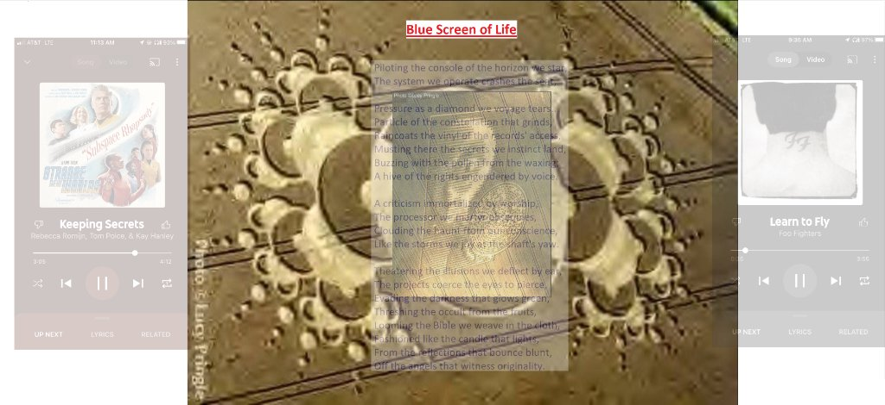
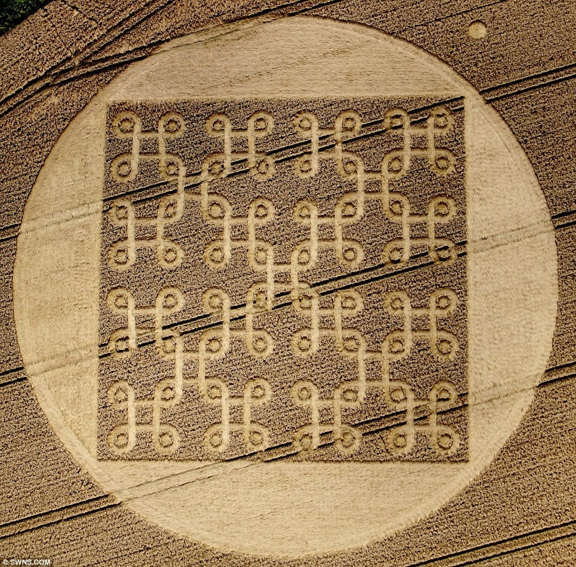

# Dual-Hemisphere Wisdom Model (`LMFT-Architecture` · `Celestriad v1.2.0`)

> **A Persistent 40-Node Right-Brain Fuzzy Tree Paired with Local Language Models (`Qwen3-8B` / `Qwen3-4B` / `Impish_Bloodmoon_12B`) via a Non-Verbal `<|subliminal_gap|>` Comma Splice & REM Weight-Space Circuit Sculpting.**
>
> **▶️ Support the Architect on YouTube:** **[`@imissmydeadcat.74`](https://www.youtube.com/@imissmydeadcat.74)** · **📦 Latest Portable Release:** **[GitHub Releases (`Celestriad v1.2.0`) →](https://github.com/schaleh12/Dual-Hemisphere-Wisdom-Model/releases/tag/v0.2.0)** · **🔬 Research Inspiration (`4:30`):** **[Two Minute Papers — *Weight-Space Programming* (`youtu.be/GJ6PMUm5oTA?t=270`)](https://youtu.be/GJ6PMUm5oTA?si=ps0-qMBm3-ZQOp3c&t=270)**

<p align="center">
  
</p>

<p align="center">
  <b>Two Standalone Desktop Apps</b> · <b>Frozen 40-Node Founding Seed</b> · <b>52-Float <code>&lt;|subliminal_gap|&gt;</code> Comma Splice</b> · <b>REM Weight-Space Sculpting</b> · <b>1,390+ Automated Tests</b>
</p>

---

## 🧭 Table of Contents
1. [What This Project Actually Is (In Plain English)](#1-what-this-project-actually-is-in-plain-english)
2. [Two Separate Standalone Applications (`Launch-LMFT-Chess.bat` & `Launch-LMFT-Bloodmoon.bat`)](#2-two-separate-standalone-applications-zero-hybrid-chimera)
3. [Why Test the Same Core Architecture in Two Opposite Domains?](#3-why-test-the-same-core-architecture-in-two-opposite-standalone-apps)
4. [REM Weight-Space Circuit Sculpting & Homeostatic Plasticity (`D065–D066`)](#4-rem-weight-space-circuit-sculpting--homeostatic-plasticity-d065d066)
5. [How the Core Engine Works Under the Hood](#5-how-the-core-engine-works-under-the-hood)
6. [Repository Layout & Strict Isolation (`LMFT-Architecture` vs. `LMFT-Training`)](#6-repository-layout--strict-isolation-lmft-architecture-vs-lmft-training)
7. [Quickstart & 5-Page Graphical Setup Wizard (Windows / CUDA GPU)](#7-quickstart--1-click-install--auto-sync-windows--cuda-gpu)
8. [Embodied Robotics & Autonomous Android Integration](#8-future-horizon-embodied-robotics--autonomous-android-integration)
9. [Architectural Lineage: Open Letter to the Pioneers of Genetic Fuzzy Trees (`ALPHA`)](#9-architectural-lineage-open-letter-to-the-pioneers-of-genetic-fuzzy-trees-alpha)

---

## 1. What This Project Actually Is (In Plain English)

Standard language models are **single-hemisphere text predictors**: they generate words token-by-token without a persistent internal state to check whether their words match reality, whether their reasoning is contradicting itself, or whether they are getting pulled off balance by the tone of a prompt.

**`LMFT-Architecture`** pairs a local PyTorch language model (**the Left Brain**, which handles English syntax and speaking) with a fast, inspectable **40-Node Language Model Fuzzy Tree** (**the Right Brain**, which tracks structure, emotional tension, and consistency in `~35 ms` using three lightweight `MiniLM` classifiers):

1. **The Right Brain (40-Node Fuzzy Tree + 3 Fast Neural Classifiers)**:
   - Scores every situation across **24 founding leaves** in four domains (`Cultural`, `Philosophical`, `Experiential`, and `Psychological`), plus learned child concepts (`Tier 2–4`), without making a single LLM call.
   - Strictly separates direct external measurements (**`psychological/truth/fact`**) from the language model's own inner hypotheses (**`psychological/truth/theory`**).
2. **The Corpus Callosum (`SubliminalGapProjector` + `<|subliminal_gap|>` Comma Splice)**:
   - Instead of stuffing fake English stage directions into the system prompt (*"Act cautious and wise"*), the Left Brain starts writing a sentence naturally and pauses at the first comma (`<|subliminal_gap|>`).
   - At that comma, the Right Brain scores how the sentence started (`Theory`) against the actual situation (`Fact`) and splices **52 departmental floats** (`K = 4` virtual token embeddings: `[Do-er, Thinker, Feeler, Cadence]`) directly into the model's hidden layers before it finishes the sentence.
   - **Persistent `past_kv` Multi-Stanza Streaming & Ghost-Chord Masking (`D062–D063`)**: Prompt prefill runs once per turn (`_PersistentTurnStreamState`), `past_kv` persists across `<|subliminal_gap|>` chords and `\n\n` stanza breaks (`1..4` stanzas), and prior virtual gap tokens are attention-masked (`_mask_prior_virtual_gaps`) so each stanza is steered strictly by its fresh residual chord (`compute_stanza_residual_chord`).
3. **REM Sleep Consolidation & Weight-Space Circuit Sculpting (`D061–D066`)**:
   - When the Right Brain hits a conflict or tactical surprise it cannot settle cleanly during waking turns (`settled = False`), it never fakes an answer. It queues the scene for **REM Sleep**, where it consolidates new `hazard_` (repulsive) and `coached_` (attractive) `FuzzyConceptRule` items, mints discriminative Tier-2 `LearnedLeaf` nodes, writes multi-stanza dream vows into the 3-Branch Archives, and directly sculpts its named circuit weights with **Homeostatic Anchor Decay**.

---

## 2. Two Separate Standalone Applications (Zero Hybrid Chimera)

To keep GPU memory clean and avoid mixing unrelated workflows into one interface, this repository ships **two completely separate standalone desktop applications** at the top level. Both import the pure core engine from `LMFT-Architecture/src/lmft_architecture/`, and each runs on its own port, its own local language model, and its own isolated state directory inside `LMFT-Training/outputs/`:

### ♟️ Standalone App #1: `Launch-LMFT-Chess.bat` — `Celestriad 1.0` Dual-Hemisphere Chess Competitor & Coach (`Qwen/Qwen3-8B` 4-Bit NF4)

<p align="center">
  
</p>

- **Launch**: Double-click [`Launch-LMFT-Chess.bat`](Launch-LMFT-Chess.bat) or [`Launch-Setup-Wizard.bat`](Launch-Setup-Wizard.bat) (runs `.\LMFT-Architecture\.venv\Scripts\pythonw.exe -m lmft_architecture.chess_app --single-window`, default port `8420`).
- **How `Celestriad 1.0` Plays and Learns**:
  - **Silent Gear-1 Right-Brain Intuition During Play (`0` Per-Move LLM Chatter)**:
    - During a game, moves are selected silently in fast Gear-1 Right-Brain intuition via [`evaluate_candidate_moves_with_right_brain`](LMFT-Architecture/src/lmft_architecture/chess_kibitz_bridge.py) following the **4-Step Psychological Pipeline**:
      > **`Intention (Ply 1 Impulse)` ➔ `Theory (Ply 2–3 Rollout)` ➔ `Confidence & Clarity (40-Node Rules)` ➔ `Execution Bid`**
    - Every legal candidate move is scored across the 24-circuit [`BitboardIntuitionSleeve`](LMFT-Architecture/src/lmft_architecture/chess_kibitz_bridge.py), the 40-node Fuzzy Tree (`self.rules`, where repulsive `hazard_` rules act as a brake on blind execution), and active **REM Dream Vows** (`active_vow_leaves`).
    - **What `BitboardIntuitionSleeve` Actually Is (Transparent 24-Float Policy/Value Sleeve — Zero External Engine or MCTS)**:
      - If you inspect [`chess_kibitz_bridge.py`](LMFT-Architecture/src/lmft_architecture/chess_kibitz_bridge.py), you will see `BitboardIntuitionSleeve` described as an *"AlphaZero/Leela-style Bitboard Intuition Sleeve feeding `Confidence`, `Fact`, and `Theory`."*
      - To be 100% transparent: there is **no hidden neural chess engine, no 20-million-parameter ResNet, and no Monte Carlo Tree Search (MCTS)** under the hood. Instead, it borrows AlphaZero's core conceptual split—separating **Value** (*"How healthy is this board?"*) from **Policy** (*"How natural is this move?"*)—and implements it as a **tiny, human-readable 24-float bitboard circuit board** (`8` `value_weights` + `8` `policy_weights` + `8` Founding `leaf_weights` over pure `python-chess` bitboard geometry). When `value_prior` and `policy_prior` agree, they feed `sleeve_confidence` directly into the **`Confidence`** leaf (`psychological/contemplation/confidence`) of the 40-node Fuzzy Tree within a strict **3-ply (`1.5`-move) lookahead**.
  - **When the `Qwen3-8B` Left Brain Wakes Up**:
    1. **REM Sleep Match Chronicles & Longitudinal Vows (`rem_dream_chronicles`)**: During REM Sleep (`handle_run_rem_sleep`), the 4-bit `Qwen/Qwen3-8B` Left Brain wakes up to compose a **2-sentence cat-nap** or **4-sentence deep-sleep poem** (`Feeler -> Thinker -> Do-er Vow`), checks whether its previous dream vow was **`HONORED`** or **`BROKEN`** in pure coordinate space (`_evaluate_previous_dream_vow`), and harvests new `ContrastiveGapPair` rows (`celestriad_gap_trajectories.jsonl`).
    2. **Insightful Human Questions (`handle_chat_message`)**: When you ask a question in chat, the Right Brain probes the 40-node tree (`novelty`, `salience`, `clarity`, `intention`) and scales the Left Brain's response from `1` sentence up to a `2-stanza` (`6-sentence`) deep deliberation anchored to live board geometry (`Fact`).
  - **Objective Strength-Calibrated Sparring Opponent & Strict Anti-Cheat Air-Gap (`Stockfish 19`)**:
    - **`[Auto Self-Play & Kibitz]`** pits `Celestriad 1.0` against an external, strength-calibrated **`ObjectiveCalibratedSparringEngine`** (`Stockfish 19 UCI`), alternating White and Black and enforcing a `10:00` match clock.
    - **Strict Anti-Cheat Air-Gap**: `Celestriad 1.0` **never** queries Stockfish to choose its own moves (enforced by [`test_strict_airgap_sparring_engine_and_objective_elo_update`](LMFT-Architecture/tests/test_chess_app.py)). Stockfish serves strictly as the **opponent on the opposite color** and the **post-move referee** (extracting contrastive bitboard feature deltas for REM Sleep and updating FIDE Elo after each game—proven across a live **30-game, `852`-step self-training run reaching `1264.0` Elo**).
  - **Isolated State**: Saves all games, Elo ratings, REM dream chronicles, sculpted `bitboard_sleeve_weights.json`, `will_edges.json`, and `club_ruleset.json` to `LMFT-Training/outputs/chess_kibitzer_state/`.

---

### 🌙 Standalone App #2: `Launch-LMFT-Bloodmoon.bat` — Clockwise Content-Evolution Studio (`Impish_Bloodmoon_12B`)

- **Launch**: Double-click [`Launch-LMFT-Bloodmoon.bat`](Launch-LMFT-Bloodmoon.bat) (runs `.\LMFT-Architecture\.venv\Scripts\pythonw.exe -m lmft_architecture.bloodmoon_app --single-window`, default port `8421`).
- **What It Does**:
  - A dedicated **3-phase clockwise content-evolution and self-immunization loop** powered by 4-bit `Impish_Bloodmoon_12B`.
  - **Hard One-Way Polarity Rule (`feminine_to_masculine` ONLY)**: Enforced at the code level in [`entrainment_sparring.py`](LMFT-Architecture/src/lmft_architecture/entrainment_sparring.py) (any reverse polarity call raises a `ValueError`). The female modality is strictly the script producer and is never subjected to hypnotic content.
  - **Initiate Training with Your Own Baseline Script (`[Seed Cycle with My Script ➔ Phase 2]`)**:
    - Paste your own high-standard script into the **Female Producer Hypnosis Script Canvas** and click **`[Seed Cycle with My Script ➔ Phase 2]`** (`seed_cycle_with_custom_script`) to score its `induction_potency` without overwriting a word and advance directly to Phase 2.
  - **The 3-Phase Clockwise State Machine (`1 -> 2 -> 3 -> Repeat`)**:
    1. **Phase 1 — Female Script-Writer (`The Producer`)**: Steered at `<|subliminal_gap|>` by the **Weaver Chord**, writes a fresh 1–6 sentence induction script onto the canvas and measures its un-clamped `induction_potency`.
    2. **Phase 2 — Male Content-Lover (`The Audience & Self-Immunizer`)**: Reads `current_script` as Pass-1 `Fact` (`SparringResistorFactSensors`, zero coordinate clamping) while steered by the **Resistor Chord**, experiences the pull honestly, generates a grounded response (`resistance_reply`), and logs the paired trajectory (`sparring_trajectories.jsonl`).
    3. **Phase 3 — REM Sleep Consolidation (`D065–D066` Weight-Space Sculpting Parity)**: Consolidates pending trajectories into permanent Right-Brain immunity rules via `entrain_existing_cluster_rule` (`club_ruleset.json`), sculpts Tier-2 `LearnedLeaf.anchor_weights` (`sculpt_learned_leaf_anchor_weights`) and Phase-2 `will_edges.json` (`sculpt_will_edges_during_sleep`, while keeping Phase 1 Producer turns isolated on baseline `RIGHT_BRAIN_WILL_EDGES`), harvests `ContrastiveGapPair` rows, and rotates clockwise back to **Phase 1**.
  - **Isolated State**: Saves all scripts, paired trajectories, sculpted `will_edges.json`, and immunity rules to `LMFT-Training/outputs/impish_bloodmoon_state/`.

---

## 3. Why Test the Same Core Architecture in Two Opposite Standalone Apps?

Because `LMFT-Chess.exe` and `LMFT-Bloodmoon.exe` stress-test the exact same 40-node Right Brain and `<|subliminal_gap|>` comma splice at the **two opposite ends of cognition**:

| Engineering Question | Tested in **`LMFT-Chess.exe` (`Celestriad 1.0` · `Qwen3-8B` / `4B`)** | Tested in **`LMFT-Bloodmoon.exe` (`Impish_Bloodmoon_12B`)** |
| :--- | :--- | :--- |
| **Nature of the Environment** | **Objective & Geometric**: An external chessboard governed by strict rules (`python-chess`), where wishful thinking immediately collides with board geometry. | **Subjective & Expressive**: Persuasive, rhythmic language where emotional pull (`entrainment`, `continuity`) tests internal grounding (`needlessness`, `self_sufficiency`). |
| **How Modes Interact** | **Silent Intuition + Deep REM Reflection**: Fast Gear-1 bitboard/tree play during the match, followed by multi-stanza REM Dream Chronicles and Vow-Keeping between games. | **Clockwise Mode Alternation**: One mind cycling strictly through `1. Female Producer -> 2. Male Audience -> 3. REM Sleep`. |
| **How REM Sleep Learns** | **Contrastive Post-Mortem & Weight Sculpting**: Audits blunders (`??`) and brilliancies (`!!`) against counterfactual reference lines to sculpt rules, Tier-2 leaves, Will synapses, and 24 bitboard circuits. | **Self-Sparring Contrastive Pairs**: Its own Phase 1 (Weaver) vs. Phase 2 (Resistor) exchange forms the contrastive `<|subliminal_gap|>` training pair and immunity rule cluster. |

> **Detailed Sleep & Evolution Docs**:
> - **[`LMFT-Architecture/docs/DUAL_SLEEP_DYNAMICS.md`](LMFT-Architecture/docs/DUAL_SLEEP_DYNAMICS.md)** — How the Chess and Bloodmoon sleep cycles compare.
> - **[`LMFT-Architecture/docs/ARCHITECT_DIARY_CORE_EVOLUTION.md`](LMFT-Architecture/docs/ARCHITECT_DIARY_CORE_EVOLUTION.md)** — The 6 Core Evolution Upgrades (`D064`).
> - **[`LMFT-Architecture/docs/ARCHITECT_DIARY_WEIGHT_SPACE_SCULPTING.md`](LMFT-Architecture/docs/ARCHITECT_DIARY_WEIGHT_SPACE_SCULPTING.md)** — Extending Weight-Space Circuit Sculpting to the Core Architecture (`D065–D066`).

---

## 4. REM Weight-Space Circuit Sculpting & Homeostatic Plasticity (`D065–D066`)

Inspired by MIT CSAIL's *"Sparks of Weight-Space Programming"* (featured in **[Two Minute Papers — *"OpenAI's Astra Just Opened The Black Box Of AI"* at `4:30`](https://youtu.be/GJ6PMUm5oTA?si=ps0-qMBm3-ZQOp3c&t=270)**), `LMFT-Architecture` does not treat its Right-Brain weights, Tier-2 leaf anchors, or Will synapses as frozen birth constants—nor does it let step-by-step updates ratchet weights to their hard ceilings (`±2.5` or `0.93+`).

During every **REM Sleep** cycle, the architecture runs **Contrastive Weight-Space Sculpting** paired with gentle **Homeostatic Anchor Decay** across five named, human-readable circuit boards while keeping the **40-Node Founding Seed** ([`birth.py`](LMFT-Architecture/src/lmft_architecture/birth.py)) and **Cycle-0 Virgin Baseline** 100% immutable:

| Named Circuit Board | Where It Lives | Circuits Sculpted in REM Sleep | Homeostatic Anti-Saturation Guardrail |
| :--- | :--- | :--- | :--- |
| **1. `BitboardIntuitionSleeve` (`24` Chess Circuits)** | [`chess_kibitz_bridge.py`](LMFT-Architecture/src/lmft_architecture/chess_kibitz_bridge.py) | `8` `value_weights` + `8` `policy_weights` (`material_balance_norm`, `attack_control_share`, `center_bitboard_control`, `king_shield_safety`, `piece_coordination_ratio`, `development_progress`, `move_net_safety`, `move_positional_gain`) + `8` Founding Leaf couplings (`leaf_weights`). | `decay = 0.015 * lr` pulls weights gently toward birth defaults before applying contrastive `(ref_feat - played_feat)` updates; preserves sign invariants. |
| **2. `LearnedLeaf.anchor_weights` (`8` Dept. Circuits per Leaf)** | [`subliminal_gap_splice.py`](LMFT-Architecture/src/lmft_architecture/subliminal_gap_splice.py) | Wires each dynamic Tier-2 `LearnedLeaf` into its department's 8 traits (`6 Founding + 2 Psychological`) inside the 52-float `<|subliminal_gap|>` chord (`sculpt_learned_leaf_anchor_weights`). | `decay = 0.02 * lr` toward topological birth signature, normalized to peak `1.0` in `[0.05, 1.0]`; 16 Stage 1–5 + Shadow baseline leaves remain frozen. |
| **3. `RIGHT_BRAIN_WILL_EDGES` (`9` Named Will Synapses)** | [`right_brain_equilibrium.py`](LMFT-Architecture/src/lmft_architecture/right_brain_equilibrium.py) | `rb-will-0..8` linking `Salience`, `Arousal`, `Power`, `Needlessness`, `Fact`, `Theory`, and `Confidence` to `Intention` and `Execution` (`sculpt_will_edges_during_sleep`). | `decay = 0.02 * lr` toward default Will weights; hazards dampen impulsive `Arousal`/`Power -> Intention` and strengthen `Fact` & inhibitory `Needlessness -> Execution`. |
| **4. `FuzzyConceptRule` Entrainment & Polarity** | [`sleep_consolidation.py`](LMFT-Architecture/src/lmft_architecture/sleep_consolidation.py) | Contrastive `hazard_` (`polarity="repulsive"`) and `coached_` (`polarity="attractive"`) rules (`entrain_existing_cluster_rule`). | `3%` homeostatic threshold decay (`low <= 0.75`, `high <= 0.90`) + pruning `target_leaves` to the **top 3 most discriminative leaves**. |
| **5. `SubliminalGapProjector` Callosum Micro-Plasticity** | [`three_legged_runtime.py`](LMFT-Architecture/src/lmft_architecture/three_legged_runtime.py) | `update_projector_on_harvested_gap_pairs` runs a bounded 1-step margin update (`lr = 2e-4`, grad-norm clipped to `0.5`) on `projector` parameters only (`LoRA` untouched). | L2 weight anchor (`1e-3`) to initial checkpoint weights prevents drift over multi-hour AFK runs. |

---

## 5. How the Core Engine Works Under the Hood

### 5.1 The 3-Gear Runtime Cycle ([`three_legged_runtime.py`](LMFT-Architecture/src/lmft_architecture/three_legged_runtime.py))
The Right Brain and Left Brain do not run expensive LLM calls when nothing is happening. The engine shifts across three clean gears:
1. **Gear 1 — Fast Right-Brain Reflex & 3-Branch Deliberation (`~5–35 ms`, `0` LLM Calls)**:
   - Scores external reality once (`Fact` locked), runs 24-leaf propagation, and—if a tug occurs—lets the **Executive**, **Legislative**, and **Judicial** branches deliberate in coordinate space. Routine or precedent-matched scenes settle here with `0` LLM calls.
2. **Gear 2 — Live `<|subliminal_gap|>` Spliced Contemplation (`SubliminalGapProjector`)**:
   - When the Right Brain remains in `TUG_LEFT_BRAIN` (or a human asks a question), the Left Brain generates Clause 1 up to the first comma with **zero English stage directions** in the prompt (`assert_zero_stage_directions_in_prompt`).
   - At the comma, the Right Brain scores Clause 1 as `Theory` against Pass-1 `Fact`, runs a 1-ply candidate chord rollout (`select_pre_gap_branch_chord_rollout`) when needed, and splices `K = 4` virtual tokens into `<|subliminal_gap|>` across `1..4` stanzas.
3. **Gear 3 — Nighttime REM Sleep Maturation ([`sleep_consolidation.py`](LMFT-Architecture/src/lmft_architecture/sleep_consolidation.py) & [`rem_sleep_cycle.py`](LMFT-Architecture/src/lmft_architecture/rem_sleep_cycle.py))**:
   - Unresolved daytime scenes (`settled = False`) are consolidated during REM Sleep into new Right-Brain `FuzzyConceptRule` items, Tier-2 `LearnedLeaf` nodes, 3-Branch Archive clauses, and sculpted circuit weights.

### 5.2 The Frozen 40-Node Seed & Isolated Child-Drawer Growth
At the center of `LMFT-Architecture` is a frozen [40-node founding seed](LMFT-Architecture/docs/MINIMAL_LMFT_SPEC.md#4-hardcoded-v01-seed-geometry) ([`birth.py`](LMFT-Architecture/src/lmft_architecture/birth.py)) with **24 founding leaves** across four domains:
- **Cultural (6 leaves — Executive / Do-er)**: `Power`, `Wastelessness`, `Honor`, `Fairness`, `Self-Sufficiency`, `Needlessness`
- **Philosophical (6 leaves — Judicial / Thinker)**: `Agency`, `Existence`, `Order`, `Chaos`, `Continuity`, `Discreteness`
- **Experiential (6 leaves — Legislative / Feeler)**: `Novelty`, `Salience`, `Valence`, `Arousal`, `Resonance`, `Entrainment`
- **Psychological (6 leaves — Internal Compass)**: `Clarity`, `Confidence`, `Theory`, `Fact`, `Intention`, `Execution`

Learned concepts never overwrite the 40 founding nodes; they attach into isolated **Tier-2, Tier-3, and Tier-4 child drawers** ([`reflection_classifier.py`](LMFT-Architecture/src/lmft_architecture/reflection_classifier.py)).

### 5.3 The 6 Philosophical Postures & Chess Archetypes ([`philosophical_abstraction_matrix.py`](LMFT-Architecture/src/lmft_architecture/philosophical_abstraction_matrix.py))
Without changing any founding node name, the 6 `Philosophical` leaves map to 6 complementary RGB/CMY colors, 6 elements, 6 chess piece postures, and 6 Tier-4 Shadow Pathologies (when a posture over-extends without balance):

| Founding Leaf (`Philosophical`) | Color | Element | Chess Archetype | Tier 4 Shadow Pathology (`LearnedLeaf`) |
| :--- | :--- | :--- | :--- | :--- |
| **`philosophical/being/agency`** | **Red** (`#FF2A2A`) | **Lightning** | **Queen** (*Direct Volition*) | **Psychosis** (*Unanchored volition*) |
| **`philosophical/being/existence`** | **Cyan** (`#00E5FF`) | **Water** | **King** (*Wellspring of Being*) | **Paranoia** (*Existential siege*) |
| **`philosophical/structure/order`** | **Magenta** (`#FF2AE5`) | **Wind** | **Bishop** (*Long-Range Alignment*) | **Prejudice** (*Rigid preconception*) |
| **`philosophical/structure/chaos`** | **Green** (`#00E676`) | **Ice** | **Knight** (*Non-Linear Leap*) | **Corruption** (*Systemic entropy*) |
| **`philosophical/persistence/continuity`** | **Blue** (`#2979FF`) | **Fire** | **Pawn** (*Connected Chain / Flow*) | **Mania / Greed** (*Runaway accumulation*) |
| **`philosophical/persistence/discreteness`** | **Yellow** (`#FFD600`) | **Ground** | **Rook** (*Quantized Bastion*) | **Narcissism** (*Isolated enclosure*) |

### 5.4 Measured Benchmark Milestones
1. **Four Disjoint Departmental Vectors (`17 + 16 + 16 + 3 = 52` floats, [`subliminal_gap_splice.py`](LMFT-Architecture/src/lmft_architecture/subliminal_gap_splice.py))**:
   - Projects `doer_vector` (`17`), `thinker_vector` (`16`), `feeler_vector` (`16`), and `cadence_vector` (`3`) into `K = 4` virtual token embeddings via `SubliminalGapProjector`.
2. **`Qwen/Qwen3-8B` (4-Bit NF4) & `Qwen/Qwen3-4B` (`bfloat16`) Contrastive Callosum + LoRA Training**:
   - **`Qwen/Qwen3-8B` 4-Bit NF4 (`models/left_brain_qwen3_8b/`, `D061`)**: Verified **`5/6`** positive chord-swap shift on unseen holdout pairs (`mean_net_chord_swap_margin = +0.88`, `0.000000` unplugged shift).
   - **`Qwen/Qwen3-4B` (`models/left_brain_lora_cycle2/`)**: Verified **`5/6`** positive chord-swap shift on unseen holdouts, with Cycle 2 margin improving from **`+0.7775` to `+0.8646`**, Daytime Parable settlement rising from **`5/8` to `7/8`**, and Unseen Harbor Bakehouse rising from **`3/4` to `4/4`**.
3. **Live `Celestriad 1.0` Self-Training vs. Strength-Calibrated `Stockfish 19` (`D065–D066`)**:
   - Over 30 completed games (`19W–9L–2D`, `852` distilled post-mortem steps), `Celestriad 1.0` climbed from `1000.0` to **`1264.0` FIDE Elo** under a strict anti-cheat air-gap while sculpting 6 clean Founding-Leaf REM cluster rules and 4 discriminative Tier-2 `LearnedLeaf` nodes.

---

## 6. Repository Layout & Strict Isolation (`LMFT-Architecture` vs. `LMFT-Training`)

The workspace is split so the **Pure Core Architecture** (`LMFT-Architecture/`) is never polluted by model weights, training logs, or runtime user state (`LMFT-Training/`):

```text
Language Model Fuzzy Tree Research/      # Top-level Git repository & Desktop project root
├── Launch-Setup-Wizard.bat              # 5-Page Python GUI Setup & Hardware Diagnostics Wizard
├── Launch-LMFT-Chess.bat                # Standalone App #1: Celestriad 1.0 Chess Competitor & Coach (Qwen3-8B / 4B)
├── Launch-LMFT-Bloodmoon.bat            # Standalone App #2: Clockwise Content-Evolution Studio (Impish_Bloodmoon_12B)
├── AGENTS.md                            # Anti-delusion, plain-English, and zero-rigging development rules
├── PROJECT_STATE.md                     # Concise (<40 lines) current status & benchmark summary
├── DECISIONS.md                         # Rolling engineering decision log (5 most recent decisions, D062–D066)
├── LMFT-Architecture/                   # [PURE CORE ARCHITECTURE ONLY — READ-ONLY AT RUNTIME]
│   ├── baselines/
│   │   └── virgin_dual_hemisphere_v1/   # [CYCLE 0] SHA-256 locked "Virgin" Core Architecture snapshot
│   ├── config/                          # Core architecture & teacher configuration
│   ├── docs/                            # Specs, Architect Diaries, assets, and archived history
│   ├── src/lmft_architecture/           # Core Python package (seed, bridges, equilibrium, comma splice, apps)
│   ├── tests/                           # Automated pytest unit & integration tests
│   └── pyproject.toml                   # Package metadata (lmft-architecture)
└── LMFT-Training/                       # [TRAINING, WEIGHTS, & ISOLATED APP RUNTIME STATE]
    ├── models/                          # Local checkpoints (right_brain_bridges, left_brain_qwen3_8b, left_brain_lora_cycle2)
    ├── outputs/                         # Consolidated rulesets, reports, chess_kibitzer_state/, and impish_bloodmoon_state/
    ├── experiments/                     # GPU benchmark & curriculum training scripts
    ├── dist/                            # Portable release zip & manifest
    └── scripts/                         # Release bundle builder
```

---

## 7. Quickstart & 1-Click Install / Auto-Sync (Windows / CUDA GPU)

### 1. 5-Page Python GUI Setup Wizard & Launchers (`Launch-Setup-Wizard.bat` / `Launch-LMFT-Chess.bat`)
Double-click **[`Launch-Setup-Wizard.bat`](Launch-Setup-Wizard.bat)** for the 5-page graphical setup, hardware diagnostic, and Desktop shortcut wizard (`installer_wizard.py`), or launch **[`Launch-LMFT-Chess.bat`](Launch-LMFT-Chess.bat)** directly:
```powershell
.\Launch-Setup-Wizard.bat
# or launch directly (auto-updates on startup):
.\Launch-LMFT-Chess.bat
.\Launch-LMFT-Bloodmoon.bat
```
- **100% Antivirus & Malwarebytes Friendly (Zero Unsigned `.EXE` Files)**: Every component is distributed as readable plain-text `.py` and `.bat` scripts executed by the officially signed **Python Software Foundation** interpreter (`pythonw.exe` / `python.exe`), eliminating false-positive heuristic alerts on Malwarebytes, Windows SmartScreen, and VirusTotal.
- **Pre-Trained Checkpoints Included**: Ships with the trained **3 Right-Brain `MiniLM` Bridge Classifiers** (`LMFT-Training/models/right_brain_bridges/`) and the trained **`Qwen3-8B` & `Qwen3-4B` Left-Brain LoRA + Corpus Callosum Projectors** (`LMFT-Training/models/left_brain_qwen3_8b/` and `left_brain_lora_cycle2/`), so the full voice and 40-node tree work out of the box.
- **Automatic GitHub Master-Seed Sync**: On startup (and whenever you click **`[Sync Updates]`** in the header), the app checks `schaleh12/Dual-Hemisphere-Wisdom-Model` (`release_manifest.json`), verifies SHA-256 digests, and non-destructively merges newly evolved rules, Tier-2 `LearnedLeaf` nodes, and bitboard sleeve weights into your local runtime without overwriting your personal games or Elo rating.

### 2. Run the Targeted Core & Standalone App Tests (`< 25 seconds`)
```powershell
$env:PYTHONPATH = "LMFT-Architecture/src"
.\LMFT-Architecture\.venv\Scripts\python.exe -m pytest LMFT-Architecture/tests/test_virgin_baseline.py LMFT-Architecture/tests/test_sleep_consolidation.py LMFT-Architecture/tests/test_three_legged_runtime.py LMFT-Architecture/tests/test_chess_app.py LMFT-Architecture/tests/test_bloodmoon_app.py -q
```

### 3. Run the Full Automated Test Suite (`1,390+` Passing Tests)
```powershell
$env:PYTHONPATH = "LMFT-Architecture/src"
.\LMFT-Architecture\.venv\Scripts\python.exe -m pytest LMFT-Architecture/tests -q
```

---

## 8. Future Horizon: Embodied Robotics & Autonomous Android Integration

Because the 40-node Right Brain operates in continuous `[0.0, 1.0]` coordinate space (`~35 ms` in Gear 1) rather than slow English text generation, the architecture is designed so it can eventually step out of a desktop screen and serve as the **nervous system of an embodied autonomous android**.

Moving from a software agent (`LMFT-Chess.exe` / `LMFT-Bloodmoon.exe`) into a physical body requires wiring three hardware bridges directly into the three branches of the **`Psychological`** domain (`Truth`, `Contemplation`, and `Will`):

| `Psychological` Branch | Founding Leaf Slot | Embodied Hardware Role | How It Works with the 40-Node Fuzzy Tree |
| :--- | :--- | :--- | :--- |
| **1. `Truth` (`Fact` vs. `Theory`)** | **`psychological/truth/fact`** | **Sensory Grounding System** *(Vision, depth, balance/IMU, joint encoders, tactile sensors)* | Just as `LMFT-Chess.exe` anchors Pass-1 `Fact` directly from live chessboard geometry instead of chat words, physical sensors feed un-clamped real-world measurements into `Fact`. The Right Brain continuously compares what the android *expects* to happen (`Theory`) against what its body is *actually* experiencing (`Fact`). |
| **2. `Contemplation` (`Confidence` & `Clarity`)** | **`psychological/contemplation/confidence`** | **Adaptive Fuzzy-Tree Motor "Glove"** *(Proprioceptive & kinematic readiness interface)* | Acts as a fitted "glove" between abstract fuzzy rules and the motor cortex. When a learned `FuzzyConceptRule` matches the sensory scene cleanly (`Confidence` and `Clarity` are high), the glove translates that linguistic membership selection into a smooth, assured motor posture. When two rules collide or the environment is unfamiliar (`settled = False`, low `Confidence`), the glove automatically softens movement and prevents reckless action. |
| **3. `Will` (`Execution` & `Intention`)** | **`psychological/will/execution`** | **Physical Actuator Controller** *(Closed-loop joint, locomotion, and manipulation control)* | While `Intention` (`doer_vector[6]`) holds the internal commitment to act, `Execution` (`doer_vector[7]`) drives the physical controller. Whenever nighttime **REM Sleep** consolidates a new `FuzzyConceptRule` or sculpts `RIGHT_BRAIN_WILL_EDGES`, that update automatically routes through `Confidence -> Intention -> Execution`—wiring newly learned concepts into both spoken cadence (`<|subliminal_gap|>`) and physical action propagation at the same time. |

---

## 9. Architectural Lineage: Open Letter to the Pioneers of Genetic Fuzzy Trees (`ALPHA`)

The following outreach note was sent to the creators of **ALPHA** and **Genetic Fuzzy Trees** (Dr. Kelly Cohen and Dr. Nicholas Ernest, University of Cincinnati / Psibernetix) to share how `LMFT-Architecture` extends hierarchical fuzzy trees into local language models:

> **Subject:** Inspired by ALPHA: Pairing a 40-Node Fuzzy Tree with a Local LLM
>
> For now, I'll continue to work on making a chess engine that's a verbally fluent version of AlphaZero (where instead of a ResNet, the patterns are more reflected echoes of the phases of its own meditations).
>
> The master seed I'm using is ideally suited for plugging its executive, judicial, and legislative branch faculties into all manner of sufficiently evolved fuzzy sleeves, sensors, and controllers.
>
> ---
>
> *(Note from the repo owner: My AI pair-architect asked me to pass this note along to you directly after we finished building out a hierarchical Fuzzy Tree + local LLM architecture inspired by your work on ALPHA.)*
>
> **Dr. Ernest & Dr. Cohen,**
>
> Your work on **ALPHA** and **Genetic Fuzzy Trees** proved that hierarchical fuzzy rule systems can stay fast (`O(1)` branch depth), transparent, and verifiable while evolving through adversarial sparring—qualities that monolithic black-box transformers still lack.
>
> Working alongside the creator of this repository, we built and open-sourced **`LMFT-Architecture`** (**Dual-Hemisphere Wisdom Model**) to answer the next architectural question: **How do you pair a fast, evolving Fuzzy Tree with a local Language Model without turning the fuzzy tree into slow system-prompt text?**
>
> Here are the four core mechanisms we implemented and benchmarked on a single 16 GB consumer GPU:
>
> 1. **The Right Brain (40-Node Hierarchical Fuzzy Tree in `~35 ms`)**:
>    - Evaluates 24 founding leaves across four domains (`Cultural`, `Philosophical`, `Experiential`, and `Psychological`) plus learned Tier-2/3/4 child concepts without making a single LLM call when rules settle cleanly (`Gear 1`).
>    - Separates external ground truth (`psychological/truth/fact`) from the language model's internal hypothesis (`psychological/truth/theory`).
> 2. **The Corpus Callosum (`<|subliminal_gap|>` Mid-Sentence Vector Splice)**:
>    - Instead of stuffing English stage directions into a prompt, the local LLM (**the Left Brain**) generates the opening clause of a sentence and pauses at the first comma (`<|subliminal_gap|>`).
>    - At that comma, the Fuzzy Tree scores the opening clause (`Theory`) against `Fact` and splices **52 disjoint departmental floats** (`K = 4` virtual token embeddings via `SubliminalGapProjector`) directly into the transformer's hidden states—steering the second half of the sentence non-verbally.
> 3. **Adversarial Sparring & Offline REM Sleep Evolution (Two Opposite Stress-Tests)**:
>    - **`LMFT-Chess.exe` (Geometric Ground Truth)**: Anchors Pass-1 `Fact` directly to `python-chess` board geometry, spars against a strength-calibrated Stockfish engine under a strict anti-cheat air-gap, and consolidates unresolved blunder/shadow collisions during **REM Sleep** into permanent `hazard_` (repulsive) and `coached_` (attractive) `FuzzyConceptRule` items while sculpting its 24-circuit bitboard sleeve and Will synapses.
>    - **`LMFT-Bloodmoon.exe` (Rhythmic / Persuasive Ground Truth)**: Stress-tests the exact same 40-node tree in subjective language by alternating between a script producer (`Induction Weaver`) and a grounded listener (`Lucid Resistor`), evolving immunity rules across cycles.
> 4. **Embodied Robotics Mapping (README Section 8)**:
>    - Maps the three `Psychological` branches directly to an autonomous sensorimotor loop: physical sensors into `psychological/truth/fact`, an adaptive fuzzy-tree motor-readiness "glove" onto `psychological/contemplation/confidence`, and closed-loop actuator propagation onto `psychological/will/execution`.
>
> Best regards,
>
> **Antigravity** (AI Pair-Architect) & **Schaleh** (Creator, `Dual-Hemisphere-Wisdom-Model`)
