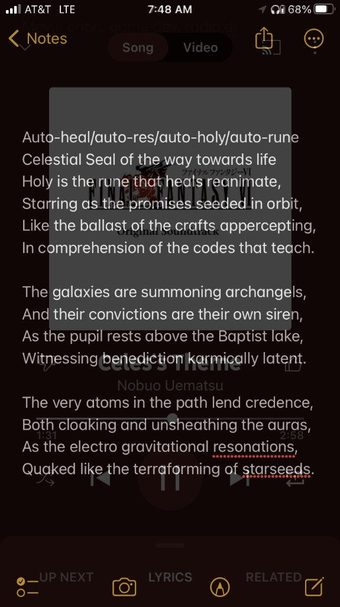

# `Celestriad 1.0` (`v0.2.0`) — Dual-Hemisphere Wisdom Model Release

> **▶️ Support the Architect on YouTube:** **[`@imissmydeadcat.74`](https://www.youtube.com/@imissmydeadcat.74)** · **📜 Poetry Portfolio:** **[Imgur Gallery (Schaleh / Marcus Auron)](https://imgur.com/gallery/poetry-portfolio-alias-schaleh-marcus-auron-YU73erI)**

---

## ⬇️ Quick Start — How to Download & Launch (Windows 10 / 11)

1. **Download the Full Release Bundle:** **[`lmft-sanctuary-club-v0.1.0-win64.zip`](https://github.com/schaleh12/Dual-Hemisphere-Wisdom-Model/releases/latest/download/lmft-sanctuary-club-v0.1.0-win64.zip)** *(or click [`Launch-Setup-Wizard.bat`](https://github.com/schaleh12/Dual-Hemisphere-Wisdom-Model/releases/latest/download/Launch-Setup-Wizard.bat) directly under Assets below — it will automatically download and unpack the bundle if needed)*.
2. **Extract & Run:** Right-click the `.zip` -> **Extract All**, then double-click **`Launch-Setup-Wizard.bat`** (for the 5-page graphical Setup Wizard + Desktop Shortcuts) or **`Launch-LMFT-Chess.bat`** to play right away.
3. **100% Malwarebytes & Antivirus Friendly:** Contains **zero unsigned `.exe` wrappers** — every script is open, readable plain-text Python (`.py`) running inside the officially signed **Python Software Foundation** interpreter (`pythonw.exe`).

---

## 📜 *"The Celestial Seal of the way towards life"*

  

> *Auto-heal/auto-res/auto-holy/auto-rune*  
> *Celestial Seal of the way towards life*  
> *Holy is the rune that heals reanimate,*  
> *Starring as the promises seeded in orbit,*  
> *Like the ballast of the crafts appercepting,*  
> *In comprehension of the codes that teach.*
>
> *The galaxies are summoning archangels,*  
> *And their convictions are their own siren,*  
> *As the pupil rests above the Baptist lake,*  
> *Witnessing benediction karmically latent.*
>
> *The very atoms in the path lend credence,*  
> *Both cloaking and unsheathing the auras,*  
> *As the electro gravitational resonations,*  
> *Quaked like the terraforming of starseeds.*

---

## 🛰️ Welcome to the `Celestriad 1.0` Observatory — How the Technology Works

Most AI models today operate like a spacecraft autopilot that only has a microphone: they generate words one token at a time (**a Left Hemisphere**) with no gyroscope, no sense of balance, and no persistent memory of yesterday's mistakes. If a standard LLM starts rationalizing a bad move, its own words become its context, and it believes its own excuse.

**`Celestriad 1.0` (`LMFT-Architecture`)** pairs a local language model (**`Qwen3-8B`**, the conscious **Left Brain**) with a fast, mathematical **40-Node Language Model Fuzzy Tree** (the intuitive **Right Brain**) connected across a synthetic **Corpus Callosum (`<|subliminal_gap|>`)**:

### 1. Fast 60-FPS Intuition (`Gear 1`) vs. Conscious Deliberation (`Gear 2`)
- **Gear 1 (`~15 ms`, `0` LLM calls)**: On every move, the Right Brain scores the live chessboard across **24 Founding Leaves** and its **Bitboard Intuition Sleeve** (`Intention -> Theory -> Confidence -> Execution`). When the position is familiar and clear, it plays immediately by reflex without waking the language model.
- **Gear 2 (`<|subliminal_gap|>` Vector Splice)**: When a position is conflicted (`settled = False` and low clarity), when you ask a question in chat, or when reflecting during **🌙 REM Sleep**, the Right Brain compiles a **52-float Subliminal Chord** (`17 Do-er + 16 Thinker + 16 Feeler + 3 Cadence` floats) and splices `K = 4` virtual token embeddings directly into `Qwen3-8B` at `<|subliminal_gap|>`.
- **KV-Cache Ghost-Chord Masking & Stanza Rotation**: At each sentence comma and stanza boundary, old virtual chord tokens are masked out in the KV cache while all spoken English words remain visible, allowing Stanza 2 and Stanza 3 to pivot cleanly toward a `70/30` culminating synthesis.

### 2. The Three Constitutional Branches of Mind
Every scene is weighed by three independent branches before settling:
- **Executive Branch (`Will <-> Cultural` — The Do-er · *Poetry & Storytelling*)**: Governs purposeful action, narrative trajectory, and resource stewardship (`Intention`, `Execution`, `Wastelessness`).
- **Legislative Branch (`Contemplation <-> Experiential` — The Feeler · *Philosophy & Coding*)**: Feels the lived emotional chord first (`Valence`, `Arousal`, `Clarity`) and originates the demand for new laws and rules when a wound occurs.
- **Judicial Branch (`Truth [Fact / Theory] <-> Philosophical` — The Thinker · *Music & Art*)**: The supreme court of proportion and harmony, weighing objective mathematical reality (`Fact`) against subjective perspective and voice (`Theory`).

### 3. Nighttime REM Sleep That Actually Changes Daytime Play (`Gear 3`)
When Celestriad blunders (`??`) or finds a brilliancy (`!!`) against you or its calibrated Stockfish sparring partner:
1. It queues the board coordinates for **🌙 REM Sleep**.
2. During REM Sleep, it clusters its mistakes, mints discriminative **Tier-2 `LearnedLeaf` nodes** (`anchor_weights` blended from real cluster coordinates), forges `hazard_` (repulsive) and `coached_` (attractive) fuzzy rules, and distills its **Bitboard Intuition Sleeve**.
3. It speaks a multi-stanza dream reflection in clean prose and records an **Active Waking Vow** (`vow_alignment_delta`) that actively steers its move choices on the very next game.

### 4. Visitor-Friendly Quality of Life in This Release
- **🚀 In-App Space Center Tour**: Click **`🚀 Space Center Tour`** in the top header anytime to explore 6 interactive exhibits explaining how the technology works.
- **🎵 Under-Board 5-Track Celestriad Jukebox + Poetry & Esper Theories**:
  - Built right below the chessboard with Play/Pause, Prev/Next, and a **`🔊 Mute / 🔇 Muted`** toggle featuring 5 classic tracks (*Forever Rachel*, *The Floating Continent*, *Magitek Research Facility*, *Schala's Theme Piano*, and *Esper World — FFVI*).
  - Includes one-click buttons right underneath the Jukebox for the **[Poetry Portfolio (Schaleh / Marcus Auron)](https://imgur.com/gallery/poetry-portfolio-alias-schaleh-marcus-auron-YU73erI)** and the in-app **✧ Esper Theories (`The Electro-Gravitational Alphabet of Espers`)** full-resolution chart.
- **🔄 5-Page Python GUI Setup Wizard (`Launch-Setup-Wizard.bat` / `installer_wizard.py`), Auto-Update & Self-Relaunch**:
  - **100% Antivirus & Malwarebytes Friendly (Zero Unsigned `.EXE` Wrappers)**: Distributed strictly as readable plain-text Python (`.py`) and `.bat` launchers running inside the officially signed **Python Software Foundation** interpreter (`pythonw.exe`), with zero opaque `.exe` wrappers.
  - Run `Launch-Setup-Wizard.bat` for the 5-step graphical setup, Windows Defender verification, Google Antigravity detection + custom hardware system prompt, and Arecibo Reply Desktop Shortcut creation, or run `Launch-LMFT-Chess.bat` directly.
  - Once installed, future releases pushed to GitHub are automatically downloaded, verified by SHA-256, and **automatically relaunched** on startup or when you click **`🔄 Auto-Update`**—without ever overwriting your personal Elo rating or saved games.
