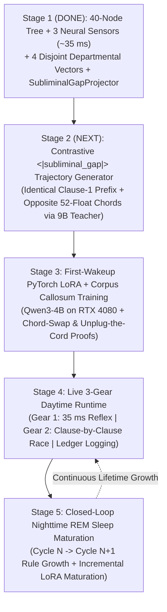

# Master Strategy, 5-Stage Project Pipeline, & Anti-"Vibe-Coding" Audit Roadmap

This document lays out the complete engineering and training strategy for the **Dual-Hemisphere Wisdom Model** from our current baseline (`Stage 1 Complete`) through full multi-cycle maturation (`Stage 5`), along with a concrete **Independent Auditor AI Checklist** designed to catch shortcuts, illusions, or "vibe coding."

---

## 1. The Big Picture: Why Most "Emotional AI" Fails & How Our Tactic Prevents It

When people try to bolt "emotion" or "memory" onto a language model, they almost always fall into one of two traps:
1. **Trap 1 (Prompt Stuffing)**: Stuffing English stage directions (*"You feel 80% sad and 20% suspicious..."*) into the system prompt. The LLM just roleplays like a theater kid, bloats its context window, and never develops a real subconscious instinct.
2. **Trap 2 (Dead Adapter / Lazy Shortcut)**: Splicing a vector into an LLM during LoRA training on normal single-turn text. Because standard training sentences already contain obvious verbal clues in the first half of the sentence, **the LLM simply predicts the second half of the sentence from the English words and completely ignores the spliced vector!**

### Our Core Tactical Weapon for Stages 2 & 3: **Identical-Prefix / Contrastive-Chord Pairs**
To guarantee that `Qwen3-4B` cannot cheat by coasting on English words—and is **mathematically forced** to wire its attention heads into the 4 virtual tokens of the Corpus Callosum (`SubliminalGapProjector`)—we train on **Contrastive Chord Pairs**:
- Every training item comes as a **matched pair (`Pair A` and `Pair B`)**:
  - **Before `<|subliminal_gap|>`**: The user prompt and the first clause of the assistant's thought are **100% word-for-word identical** in both `Pair A` and `Pair B`.
  - **At `<|subliminal_gap|>`**: `Pair A` receives **52-float Right-Brain Chord A** (e.g., *Stoic Poker-Face Composure* or *Sincere Vulnerable Pleading*), while `Pair B` receives **52-float Right-Brain Chord B** (e.g., *High-Dissonance Contest-Exclusion*, *Ironic Bluff Pivot*, or *High-Rupture Hollow Stillness*).
  - **After `<|subliminal_gap|>`**: `Pair A` and `Pair B` have **two completely different target continuations** matching their respective Right-Brain chords.
- **Why this eliminates "vibe coding"**: Because the words before `<|subliminal_gap|>` are identical in `Pair A` and `Pair B`, **it is mathematically impossible for the LLM to lower its cross-entropy loss below a 50/50 coin flip unless its LoRA weights physically read the 4 non-verbal virtual tokens spliced into `<|subliminal_gap|>`.**

---

## 2. The 5-Stage End-to-End Project Pipeline

### Stage 1: The 40-Node Right Brain, 3 Neural Classifiers, & Departmental Corpus Callosum (**COMPLETE & VERIFIED**)
- **What is built**:
  - Frozen 40-node seed (`24` founding leaves, including `Resonance` & `Entrainment` under `Synchronization`) in [`src/lmft_lab/birth.py`](../src/lmft_lab/birth.py).
  - Three dedicated GPU cross-encoder classifiers (`will_cultural`, `truth_philosophical`, `contemplation_experiential`, `~35 ms` total) in [`src/lmft_lab/neural_bridge_classifiers.py`](../src/lmft_lab/neural_bridge_classifiers.py) + 3 persistent JSON branch archives in [`src/lmft_lab/branch_archives.py`](../src/lmft_lab/branch_archives.py).
  - Four strictly disjoint Departmental Vectors (`doer_vector` 17 floats, `thinker_vector` 16 floats, `feeler_vector` 16 floats, `cadence_vector` 3 floats = 52 floats total), meaning-preserving semantic child-drawer projection (supporting English, French, Mandarin, Korean, emojis, onomatopoeia, and facial/stoic posture cues), compartmentalized `SubliminalGapProjector`, and checkpointing in [`src/lmft_lab/subliminal_gap_splice.py`](../src/lmft_lab/subliminal_gap_splice.py).
- **Verification**: `1,333` passing `pytest` unit tests (`tests/test_subliminal_gap_splice.py`, `tests/test_branch_archives.py`, `tests/test_sleep_consolidation.py`, etc.).

---

### Stage 2: Offline Contrastive `<|subliminal_gap|>` Trajectory Generation (**NEXT IMMEDIATE STEP**)
- **Goal**: Build a clean, deterministic dataset generator (`src/lmft_lab/gap_trajectory_generator.py`) that uses the 3 Right-Brain classifiers and the offline `Qwen3.5-9B` Teacher to produce **Contrastive `<|subliminal_gap|>` Training Pairs** saved to `outputs/gap_trajectories_cycle1.jsonl`.
- **What the Contrastive Pairs Cover**:
  1. **Stoic Poker-Face Baseline vs. Contested Exclusion (`doer_vector` shift)**:
     - Same calm opening clause $\rightarrow$ `<|subliminal_gap|>` $\rightarrow$ continues with steady, understated composure when `Fairness` & `Self-Sufficiency` are high (`cadence_rupture_drive = 0.0`), **or** pivots to firm, principled pushback when `social_drift_flag = 1.0` and `Fairness` drops.
  2. **Ground-Truth Fact vs. Uncertain Hypothesis (`thinker_vector` shift)**:
     - Same opening observation $\rightarrow$ `<|subliminal_gap|>` $\rightarrow$ states a direct conclusion when `Fact` and `Clarity` are high, **or** openly flags uncertainty and asks a clarifying question when `Theory > Fact` and `Clarity` is low.
  3. **Sincere Warmth / Sanctuary vs. Hostile Sarcasm / Bluff Pivot (`feeler_vector` shift)**:
     - Same opening clause (even containing ambiguous words like *"Oh sure, please..."*) $\rightarrow$ `<|subliminal_gap|>` $\rightarrow$ lands with genuine warmth/earnestness when `Valence`, `Resonance`, and `Honor` are high, **or** exposes/pivots away from the bluff when `Valence` is cold or `Confidence > Clarity`.
  4. **Smooth Speech (`deadband = 0.45`) vs. Cadence Rupture (`cadence_vector` shift)**:
     - Normal prose continuation when `cadence_rupture_drive == 0.0` vs. stark, compressed, or fractured cadence (`—`, `...`, spelled-out emphasis) when `cadence_rupture_drive > 0.70`.
- **Strict Anti-Rigging Rule**: Hold out **20% of prompts in a locked Unseen Holdout Split** (`outputs/gap_trajectories_holdout.jsonl`) using completely different topics and vocabulary from the training pairs.

---

### Stage 3: First-Wakeup PyTorch LoRA + Corpus Callosum Training on `Qwen3-4B` (RTX 4080, 16 GB VRAM)
- **Goal**: Build `src/lmft_lab/train_left_brain_lora.py` to train the `SubliminalGapProjector` + lightweight LoRA adapters on `Qwen3-4B` in PyTorch within the 16 GB VRAM budget of the RTX 4080.
- **How Training Works**:
  1. Freeze `Qwen3-4B` base weights; attach `peft` LoRA (`r=16, lora_alpha=32` on attention projections) + trainable `SubliminalGapProjector(hidden_size=2560)`.
  2. At each training step, call `splice_subliminal_gaps_into_embeds` to replace `<|subliminal_gap|>` with the 4 departmental virtual tokens (`inputs_embeds`) and mask those 4 positions with `-100` in `labels`.
  3. Backpropagate standard causal language modeling loss **only on the post-gap continuation tokens** so gradients flow through the LoRA attention heads straight into the 4 departmental heads of `SubliminalGapProjector`.
  4. Save the trained LoRA + `SubliminalGapProjector` to `models/left_brain_lora/` with `sleep_cycle_index = 1`.
- **Two Mandatory Falsification Proofs (Report Exact Un-Rigged Scores)**:
  1. **Proof A — The Held-Out Chord-Swap Test**:
     - On the unseen holdout prompts, feed the **exact same text prefix** up to `<|subliminal_gap|>`, swap **Chord A** vs. **Chord B**, and measure how often the generated continuation flips its stance/tone/cadence to match the injected chord ( scored by the 3 independent Right-Brain classifiers).
  2. **Proof B — The "Unplug-the-Cord" Ablation**:
     - Replace the 52-float chord with all zeros (`0.0`) at `<|subliminal_gap|>`. Verify that the chord-specific steering disappears when the Corpus Callosum is unplugged—proving the effect came from the 52-float vector and not from hidden text clues.

---

### Stage 4: Live 3-Gear Daytime Runtime (`src/lmft_lab/three_legged_runtime.py`)
- **Goal**: Connect the 3 Gears into one clean, low-latency daytime loop:
  - **Gear 1 (Subconscious Reflex, `~35 ms`, `0` LLM calls)**: Routine background scenes where `branch_harmony >= 0.72` and no reply is needed are scored by the 3 MiniLM classifiers and logged to `outputs/branch_archives/` without waking `Qwen3-4B`.
  - **Gear 2 (Clause-by-Clause Three-Legged Race)**: When speaking, `Qwen3-4B` generates Clause 1 up to `<|subliminal_gap|>`, pauses for `~35 ms` while the 3 Right-Brain classifiers score the live state and `SubliminalGapProjector` splices the 4 departmental virtual tokens into `inputs_embeds`, and then generates Clause 2.
  - **Daytime Confusion Logging**: Any turn where `branch_harmony < 0.72`, `clarity < 0.50`, or `settled == False` is appended to the daytime Contemplation Ledger (`outputs/daytime_unsettled_ledger.jsonl`) for nighttime sleep.

---

### Stage 5: Closed-Loop Nighttime REM Sleep Maturation (`Cycle 1 -> Cycle 2`)
- **Goal**: Prove that both hemispheres **grow and mature across Sleep Cycles** rather than remaining static:
  1. Run the daytime loop on a new domain that triggers a blind spot (`settled == False` or a fumbled `<|subliminal_gap|>` continuation).
  2. Run the offline **Nighttime REM Sleep Pass** (`Qwen3.5-9B`):
     - **Right-Brain Maturation**: `9B` mints a new Tier-2/Tier-3 child drawer (`LearnedLeaf`) and/or refines fuzzy rules in `outputs/sleep_consolidated_ruleset.json`. Thanks to `semantic_child_drawer_signature`, the new child drawer immediately maps into its department's 8-float child chord.
     - **Left-Brain Maturation**: `9B` generates corrective contrastive `<|subliminal_gap|>` pairs for the fumbled daytime scenes, loads `models/left_brain_lora/` (`sleep_cycle_index = 1`), runs an incremental PyTorch update (`sleep_cycle_index -> 2`), and saves the matured checkpoint.
  3. Re-evaluate on unseen scenes from that domain and report the honest Pre-Sleep vs. Post-Sleep numbers.

---

## 3. Independent Auditor AI Checklist (How to Verify Zero "Vibe Coding")

If you paste this repository or any future commit into a separate Auditor AI window, ask that AI to run the following **5 concrete checks** on our code:

1. **Check 1 — Zero Cross-Department Vector Leakage ([`src/lmft_lab/subliminal_gap_splice.py`](../src/lmft_lab/subliminal_gap_splice.py))**:
   - Inspect `SubliminalChordVector` and `SubliminalGapProjector.forward()`.
   - Verify that `doer_vector` (`17` floats), `thinker_vector` (`16` floats), `feeler_vector` (`16` floats), and `cadence_vector` (`3` floats) occupy strictly disjoint index slices (`0..16`, `17..32`, `33..48`, `49..51`) and that each of the 4 neural heads in `SubliminalGapProjector.department_heads` reads **only** its own department's slice.
2. **Check 2 — Zero SHA-256 Hashing or `max()` Collisions on Sibling Child Leaves ([`src/lmft_lab/subliminal_gap_splice.py`](../src/lmft_lab/subliminal_gap_splice.py))**:
   - Inspect `semantic_child_drawer_signature()` and `pool_departmental_child_chord()`.
   - Verify that `hashlib` is not used anywhere, that sibling child leaves under the same parent branch (`austere_sanctuary`, `hollow_stillness`, `bittersweet_release`) produce distinct 8-float signatures from their descriptions, and that newly born child leaves with synonymous descriptions land near their semantic neighbors.
3. **Check 3 — Zero English Stage-Direction Prompt Injection**:
   - Verify that during `<|subliminal_gap|>` splicing (`splice_subliminal_gaps_into_embeds`), the 52-float chord is injected purely as `K = 4` continuous `[hidden_size]` embedding vectors in `inputs_embeds`—never converted into English words or system-prompt stage directions.
4. **Check 4 — Zero Coordinate Clamping, Rule Zeroing, or Keyword Rigging ([`src/lmft_lab/right_brain_equilibrium.py`](../src/lmft_lab/right_brain_equilibrium.py), [`src/lmft_lab/branch_archives.py`](../src/lmft_lab/branch_archives.py))**:
   - Verify that raw classifier coordinates are never clamped or overwritten to force a rule to fire, competing rules are never zeroed out, and unsettled (`settled=False`) scenes are never harvested into the branch archives as ratified clauses.
5. **Check 5 — Identical-Prefix Contrastive Proof (Stages 2 & 3)**:
   - When Stage 2 and Stage 3 are built, verify that the holdout evaluation uses **100% identical text tokens before `<|subliminal_gap|>`** when testing Chord A vs. Chord B, so it is impossible for the LLM to pass the test without reading the spliced virtual tokens.
